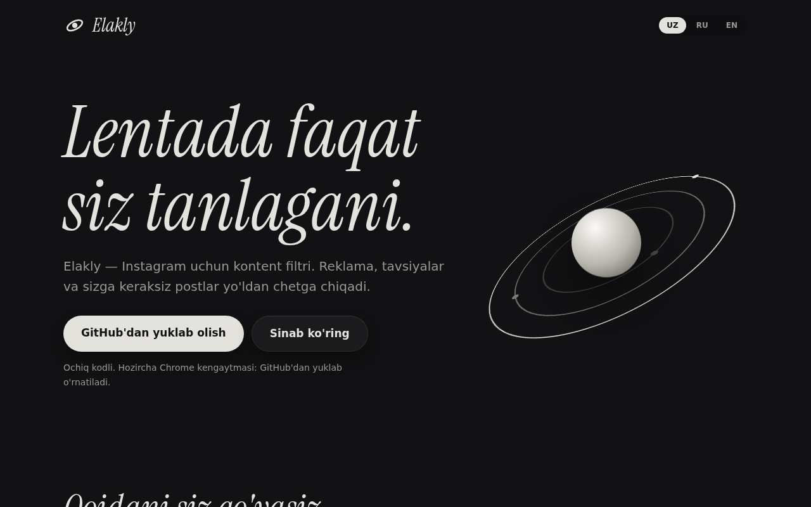
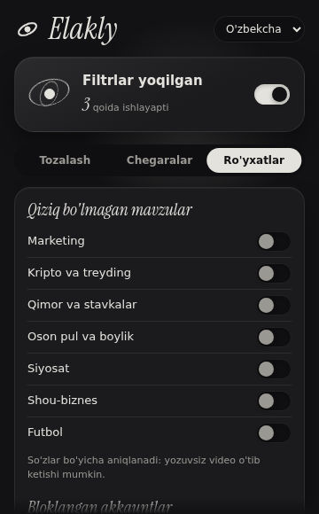

<div align="center">
  
  <h1>Elakly</h1>
  <p><b>Your Instagram feed, only what you choose.</b><br>Lentada faqat siz tanlagani. · В ленте только то, что выбрали вы.</p>
  
</div>

**Website:** [elakly.univel.uz](https://elakly.univel.uz)

An open-source content filter for Instagram. *Elak* is Uzbek for a sieve.

## Features

- Hide ads, suggested posts, paid partnerships and suggested profiles.
- Skip topics (marketing, crypto, betting, easy money, politics, celebrities, football), your own words and hashtags, or whole accounts.
- Limits on likes, views and video length; hide by type: Reels, videos, photos, carousels.
- Switch off Stories, Explore, Reels and comments, or turn Instagram black and white.
- A daily time limit.
- Optionally tell Instagram "Not interested" (off by default, at most 20 times an hour).
- Uzbek, Russian and English.



## Install (Chrome, Edge and other Chromium browsers)

1. Download this repository (**Code → Download ZIP**) and unpack it.
2. Open `chrome://extensions` and turn on **Developer mode**.
3. Press **Load unpacked** and choose the `extension` folder.

It is not in the Chrome Web Store yet.

## Privacy

Settings stay in your browser. Elakly has no server, asks for no password and sends your data nowhere. It reads the data Instagram's own page loads; the only action it can take on your account is "Not interested", if you turn it on.

## Limits

- Instagram changes its page often, so a filter can stop working until it is updated.
- Topics are detected by words: a video with no text can slip through.
- Other blockers that edit Instagram's page can interfere.
- Instagram's terms may restrict tools like this. Use it at your own risk.

## Develop

No dependencies and no build step. Tests need Node.js 20 or newer; the scripts need bash and Python 3.

```bash
node --test test/*.test.mjs
scripts/dev.sh <folder>      # copy to a folder loaded unpacked; it reloads itself
scripts/package.sh           # extension zip and the home page build
cd site && npm run dev       # home page (React, Vite, TypeScript)
```

CI runs the tests and builds the site. The server checks `main` every minute and, once CI has passed, builds and serves it with Docker Compose behind a Cloudflare tunnel (`deploy/`).

## License

[GPL-3.0](LICENSE) © 2026 Abdulmajid Yunusov. The name "Elakly" and its mark are not licensed for use by forks. Instrument Serif is under the SIL OFL 1.1 (`extension/fonts/LICENSE.txt`).

Not affiliated with or endorsed by Instagram or Meta.
